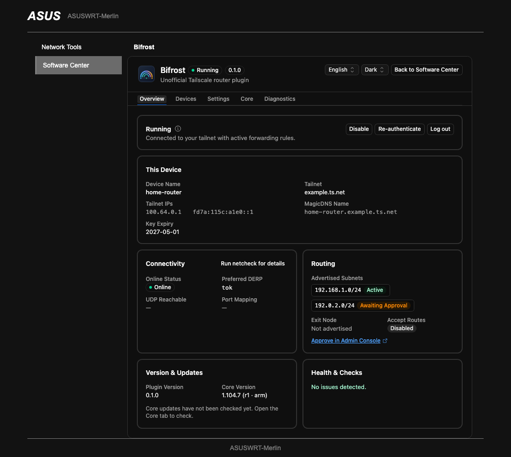
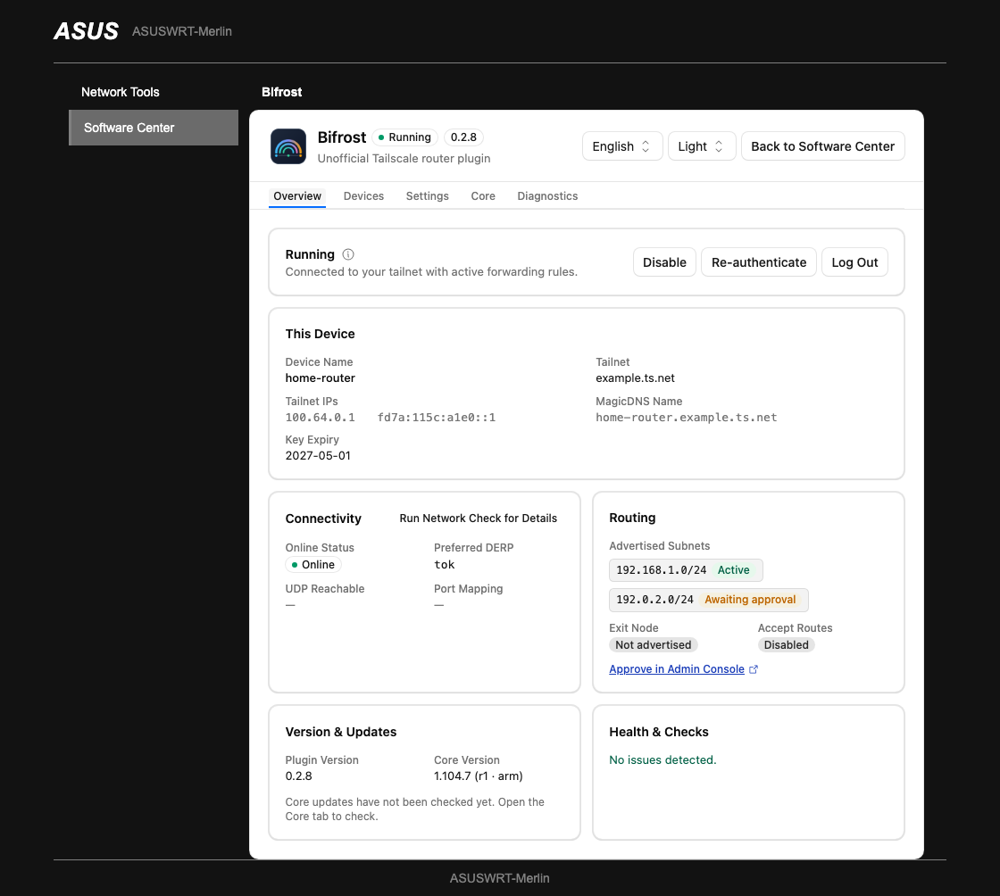
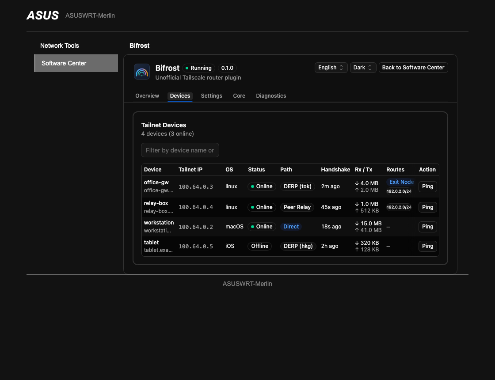
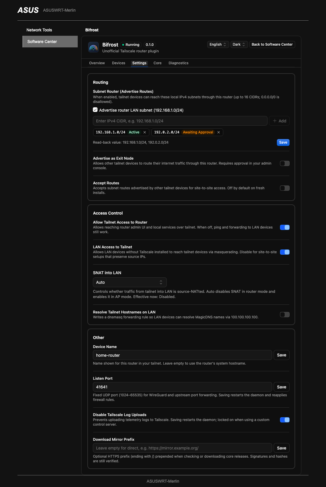
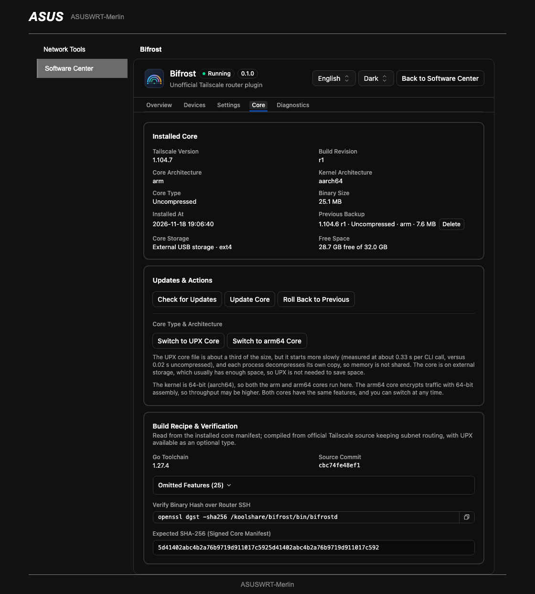
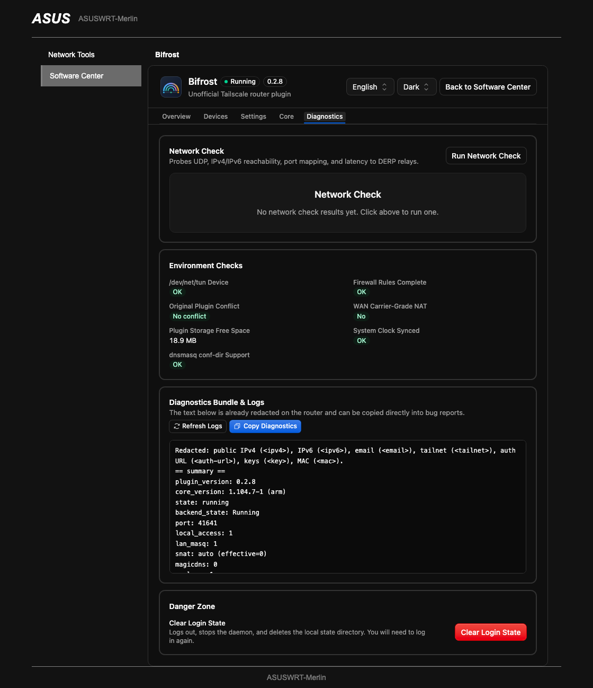
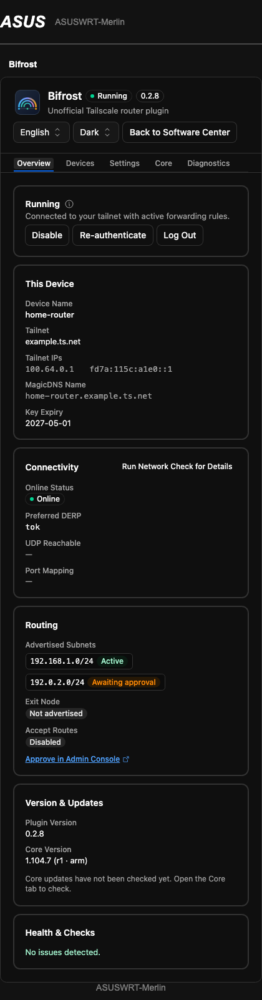

# Bifrost

English | [简体中文](README.md)

**Bifrost** is an **unofficial** Tailscale plugin for the KoolCenter / Koolshare software center on Asuswrt-Merlin 386/388 firmware (HND platform). Its core is cross-compiled from official Tailscale source using a public recipe, and its router scripts are open-source BusyBox `/bin/sh`. The web UI is built with the Kumo design system and supports Simplified Chinese / English and dark / light modes.

> [!IMPORTANT]
> Bifrost is an unofficial project and is not affiliated with, endorsed by, or sponsored by Tailscale Inc. Tailscale is a trademark of Tailscale Inc.

## How Bifrost Differs from the Original Plugin

- **Transparent, reproducible core builds**: Cross-compiled from official Tailscale stable releases (currently v1.104.7) using a public recipe (`core/recipe.json`), build script, and omitted-feature list, so anyone can rebuild and compare hashes. Binaries are installed uncompressed on JFFS (no UPX) for ~0.02 s CLI startup latency (vs ~0.94 s with UPX), and stored gzipped inside offline packages to keep software-center free-space checks low.
- **Open-source router scripts**: Every script is plain BusyBox POSIX `/bin/sh` with no obfuscation or `shc` wrapping. External inputs pass whitelist validation, `eval` is not used, and state-mutating operations run under an exclusive lock.
- **Bifrost-managed firewall chains**: `tailscaled` runs with `--netfilter-mode=off`, while Bifrost maintains its own `BIFROST_*` chains. Firmware firewall rebuilds reapply rules without restarting the daemon or dropping tailnet sessions. The local router access toggle works as expected, and CGNAT WAN traffic (`100.64.0.0/10`) is not dropped.
- **Rebuilt web UI**: Runs inside a Shadow DOM so firmware chrome stays intact. Displays device tables, path and relay indicators, route approval status, signed core updates, and redacted diagnostics. Supports Chinese / English and dark / light switching persisted in router config.
- **Self-hosted control servers & migration**: Connects as a client to headscale (interactive login and pre-auth keys) and supports **Migrate & Switch** from the original plugin with automatic rollback on failure.

## Screenshots

| Overview (Dark) | Overview (Light) |
|---|---|
|  |  |

| Devices | Settings |
|---|---|
|  |  |

| Core | Diagnostics |
|---|---|
|  |  |

| English UI | Narrow Viewport (420 px) |
|---|---|
|  |  |

> [!NOTE]
> Developed for the `ASUSWRT` firmware skin. The `ROG`, `TUF`, and `TS` skins have not been tested on physical hardware. Because the UI renders inside a Shadow DOM, its styling does not depend on firmware skins.

## Installation & Upgrades

### Requirements

- KoolCenter / Koolshare software center (Asuswrt-Merlin 386/388 firmware, HND platform, `armv7l` or `aarch64` kernel)
- `/dev/net/tun` device available (or loadable `tun` kernel module)
- `jq`, `openssl`, `curl`, and `gunzip` available on the router
- Modern browser (Chrome / Edge 123+, Safari 17.5+, Firefox 128+)

### Offline Package Installation

1. Download the offline tarball from GitHub Releases:
   - `bifrost-<version>-hnd.tar.gz` (default 32-bit `arm` core; works on all HND routers, including 64-bit kernel / 32-bit userland models).
   - When the matching core release includes `arm64`, `bifrost-<version>-hnd-arm64.tar.gz` is also provided (`aarch64` kernels only; you can also install the default package and switch online from the **Core** tab).
   - Optional: download `SHA256SUMS` and `SHA256SUMS.sig` and verify the signature and hash using **Core Updates & Signatures** below before uploading.
2. In the router web UI, go to **Software Center** → **Offline Install** and upload the `.tar.gz` package.
3. **A fresh install does not auto-start the service and never modifies the original plugin.** Open Bifrost after installation to enable it or migrate from the original plugin.

### Upgrading

- Upload the newer `.tar.gz` package directly in **Software Center** → **Offline Install** to overwrite the existing installation.
- Existing settings and the login state directory are preserved.
- A running daemon restarts automatically after upgrading; if an upgrade aborts after stopping the daemon, the installer attempts to restore the previous service.
- If a newer core (`serial`) is already installed, an older package will not downgrade it.

## Migrating from the Original Plugin

Bifrost uses its own module name, dbus keys, file paths, socket, and state directory, so it can be installed alongside the original `tailscale` plugin. Both share `tailscale0` and the device identity, so **they cannot run at the same time**.

### Migrating from the Web UI

1. Install Bifrost without enabling it first (installation leaves the original plugin untouched).
2. Open the Bifrost **Overview** tab and click **Migrate & Switch**.
3. Migration runs as a background job so it continues even if a tailnet browser session drops. It performs these steps in order:
   - Records the original device ID and public key;
   - Backs up any existing Bifrost state;
   - Stops the original plugin through its own script and disables its boot auto-start;
   - Copies `tailscaled.state` and `derpmap.cached.json` read-only without modifying original plugin files;
   - Starts Bifrost and verifies that the device identity matches;
   - Rebuilds the firewall to remove NAT rules left by the original plugin.
4. If verification fails, Bifrost stops and disables itself, restores its backup, re-enables and starts the original plugin, and reports the rollback result.

### Post-Migration & Switching Back

- Tailscale preferences (advertised routes, accept routes, etc.) live inside the state file and carry over automatically.
- `/koolshare/configs/tailscale/` is left untouched. However, after a **re-login** or **key rotation** in Bifrost, the original plugin's copy becomes stale and will require logging in again if you switch back later.
- **Manual rollback to the original plugin**: disable Bifrost in its UI, then re-enable the original plugin in its own page.

## Self-Hosted Control Servers (headscale)

Bifrost supports connecting as a client to self-hosted control servers (container-tested with **headscale v0.29.7**):

- Open **Advanced options** during login and enter your control server URL (`https://...` or `http://...`). HTTPS with a publicly trusted CA certificate is recommended; routers use the system CA bundle plus bundled Let's Encrypt roots, and **self-signed certificates are not supported**.
- Supports both **interactive login** (`AuthURL` and QR code, approved by an admin on your server) and **pre-auth keys**.
- Non-official control servers force `--no-logs-no-support` so telemetry logs are never sent to Tailscale.
- Advertised subnet routes and exit nodes must be approved on your control server (`headscale nodes approve-routes` or `autoApprovers`).
- Switching control servers creates a new login profile while keeping the previous profile in the state directory; use `bifrost switch` over SSH to switch back.

> [!WARNING]
> **Pre-auth key security**: Use single-use, short-lived pre-auth keys. Keys are never written to dbus or logs, and temporary key files are deleted immediately after the command finishes. However, the key passes briefly through request and script arguments, and travels in cleartext over LAN if the router admin UI uses HTTP (same security boundary as your router admin password).

## Settings Reference

| Setting | Default | Behavior |
|---|---|---|
| Enable Bifrost | Off | Starts/stops the daemon and controls boot auto-start (`S99bifrost.sh`). |
| Advertise routes | Empty | Advertises IPv4 CIDRs behind the router (up to 16; `0.0.0.0/0` forbidden) and shows per-route approval status. |
| Advertise exit node | Off | Lets tailnet devices route internet traffic through this router (requires control-server approval). |
| Accept routes | Off (preserved on migration) | Accepts subnet routes advertised by other devices; warns before enabling if a remote route overlaps the router's LAN. |
| Hostname | Empty (system hostname) | Custom tailnet device name (1–63 ASCII letters, digits, hyphens). |
| Listen port | `41641` | Fixed WireGuard UDP port (1024–65535) for firewall rules and upstream port forwarding; changing it restarts the daemon. |
| Allow tailnet access to router | On | When off, drops incoming connections to the router itself on `tailscale0` (keeping ICMP and established flows) while still forwarding to LAN devices behind it; warns before locking out a tailnet admin session. |
| LAN access to tailnet | On | Masquerades outbound `tailscale0` traffic so LAN devices without Tailscale installed can reach the tailnet; disable for site-to-site setups requiring original source IPs. |
| SNAT for inbound tailnet traffic | Auto | `Auto`: off in router mode, on in AP mode; `On`: always masquerade to the router LAN IP; `Off`: preserve tailnet source IPs. |
| MagicDNS for LAN clients | Off | Writes `/jffs/configs/dnsmasq.d/bifrost.conf` forwarding the MagicDNS suffix to `100.100.100.100` and restarts dnsmasq; removed on stop or uninstall. |
| Disable log uploads | On | Enables `--no-logs-no-support`; locked On when using a custom control server. |
| Download mirror | Empty | Optional `https://.../` prefix for core updates; manifest signatures and file hashes are always verified before installation. |

### Coexistence with Transparent Proxy Plugins

- Transparent proxy plugins (e.g., heimdall, merlinclash, fancyss) must bypass `100.64.0.0/10` and any accepted remote subnets so tailnet traffic is not intercepted.
- If another plugin repeatedly inserts rules ahead of Bifrost's chains, the watchdog restores ordering and logs a notice in `/tmp/bifrost-run/bifrost.log`; adjust rule ordering or bypass lists in the other plugin if they contend.

### CLI Notes

- Over SSH, run `bifrost <subcommand>` (e.g., `bifrost status`, `bifrost ping`, `bifrost switch`) to talk to Bifrost's dedicated socket directly.
- Re-logging in through the web UI runs `tailscale up --reset` with only the UI-managed flags; any extra CLI-only preferences reset to defaults.

## Core Updates & Signatures

- Core binaries are released separately under `core-<tailscale-version>-<revision>` tags and update `core.json` and `core.json.sig` in the `channel-stable` release.
- **Signing algorithm**: ECDSA P-256 with SHA-256 (verified by the router's OpenSSL 1.1.1w). Public keys live in `/koolshare/bifrost/keys/*.pub.pem` with multi-key rotation support.
- **Anti-downgrade & rollback**: Monotonic `serial` numbers block replay and downgrade attacks; the router rejects cores whose `serial` is not greater than the current one. Updates verify the manifest signature, check `.gz` and unpacked `raw_sha256`, test `--version`, then swap and verify that the service recovers within 60 s. On failure, Bifrost automatically restores the previous core and state snapshot. When JFFS space permits, `bifrostd.prev.gz` is kept for manual rollback.
- **Verifying offline release tarballs**: Verify the `SHA256SUMS` signature first, then check the tarball hash (works even if you downloaded only one architecture tarball):

```sh
# 1. Verify the SHA256SUMS signature
pubkey=plugin/bifrost/keys/release-1.pub.pem  # Set to the trusted release public key
openssl dgst -sha256 -verify "$pubkey" \
  -signature SHA256SUMS.sig SHA256SUMS

# 2. Verify the downloaded tarball (Linux)
sha256sum -c --ignore-missing SHA256SUMS

# 2. Verify the downloaded tarball (macOS)
shasum -a 256 -c --ignore-missing SHA256SUMS
```

## Uninstallation

Uninstall from the **Software Center** (runs `/koolshare/scripts/uninstall_bifrost.sh`):

- **Stop & clean up**: Stops the daemon (aborting and keeping scripts if the daemon cannot be stopped so you can retry). Removes the `bifrost_watchdog` cron job, `BIFROST_*` firewall chains, dnsmasq config, installed binaries, scripts, web assets, `/tmp/bifrost-run/`, `/tmp/upload/bifrost_*`, and all `bifrost_*` and `softcenter_module_bifrost_*` dbus keys.
- **State directory is preserved**: `/koolshare/configs/bifrost/` is kept so reinstalling does not require logging in again.
- **Full cleanup**: Before uninstalling, open the **Diagnostics** tab and click **Clear login state** (or delete `/koolshare/configs/bifrost/` over SSH after uninstalling).
- **Does not log out**: Uninstalling does not send `logout`. The router appears offline in your control plane until you remove it there.

## Limitations (Out of Scope in v1)

| Feature | Reason |
|---|---|
| Tailscale SSH, Taildrop, Taildrive, web client | Omitted at compile time to reduce binary size and attack surface. |
| Auto-updates & `tailscale update` | Updates are strictly manual; upstream self-update would overwrite Bifrost's core. |
| Using an exit node on the router | Rewriting whole-LAN default routes is high-risk; v1 only supports advertising as an exit node (CLI remains available). |
| `--accept-dns` | Kept off to avoid fighting firmware `/etc/resolv.conf`; MagicDNS is provided via dnsmasq forwarding. |
| IPv6 subnet routing & NAT | v1 covers IPv6 direct UDP connectivity and the router's own tailnet IPv6 address only. |
| Managing headscale servers | Client-only; Bifrost does not host headscale or call its admin API. |
| Multi-profile switcher UI | Switching servers keeps old profiles in state; switch back via `bifrost switch`. |
| Legacy 380 firmware, ARMv5, non-HND platforms | v1 targets HND only (`.valid` is `hnd`). |

## Development & Documentation

See [docs/README.md](docs/README.md) for the design plan, development contract, testing, packaging, and release procedures.

## License

- Plugin scripts, UI, and build tooling: [MIT License](LICENSE).
- Bundled Tailscale core: BSD-3-Clause License — see [packaging/LICENSE.tailscale](packaging/LICENSE.tailscale).
- Statically linked Go modules and frontend third-party notices: [NOTICE.md](NOTICE.md) and [packaging/THIRD_PARTY_NOTICES.core.md](packaging/THIRD_PARTY_NOTICES.core.md).
