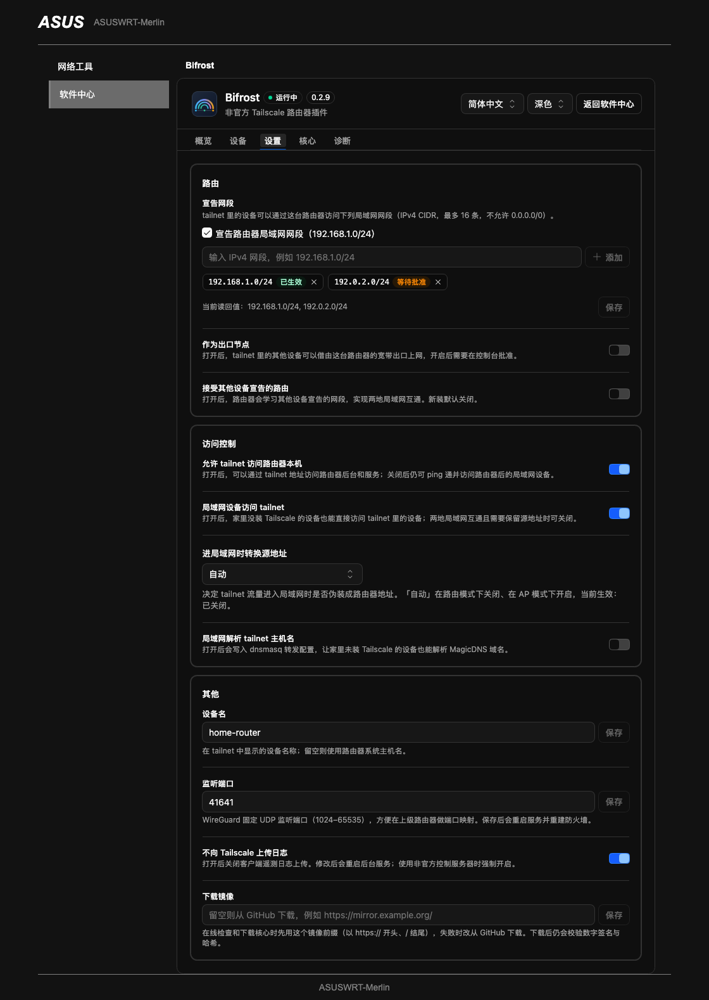
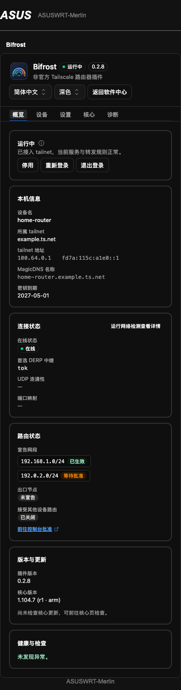

# Bifrost

English | [简体中文](README.md)

**Bifrost** is an **unofficial** Tailscale plugin for the KoolCenter / Koolshare software center on Asuswrt-Merlin 386/388 based firmware (HND platform). Its Tailscale core is built from official upstream source via a public reproducible recipe, all router scripts are open-source BusyBox `/bin/sh`, and the web UI is rebuilt with the Kumo design system featuring Simplified Chinese / English localization and dark / light modes.

> [!IMPORTANT]
> Bifrost is an unofficial project and is not affiliated with, endorsed by, or sponsored by Tailscale Inc. or Cloudflare, Inc. Tailscale is a trademark of Tailscale Inc.

## How Bifrost Differs from the Original Plugin

- **Transparent, reproducible core builds**: Cross-compiled from official Tailscale stable releases (currently v1.104.7) with a public `core/recipe.json` and feature omission list. Binaries are shipped uncompressed on JFFS (no UPX) for ~0.02 s CLI startup latency, and stored gzipped inside the offline tarball to keep software-center free-space checks low.
- **Open-source router scripts**: Every script is plain BusyBox POSIX `/bin/sh` with no obfuscation or `shc` wrapping, whitelist input validation, no `eval`, and exclusive locking for state-mutating operations.
- **Bifrost-managed firewall chains**: `tailscaled` runs with `--netfilter-mode=off`, while Bifrost manages its own `BIFROST_*` chains. Firmware firewall rebuilds restore rules without restarting the daemon or dropping tailnet sessions, the local router access toggle actually works, and CGNAT WAN traffic (`100.64.0.0/10`) is not dropped.
- **Redesigned UI**: Mounted inside a Shadow DOM so firmware chrome stays intact, offering device tables, path/relay indicators, route approval status, signed core updates, and redacted diagnostics in Chinese and English.
- **Self-hosted control servers & migration**: Supports headscale (interactive login and pre-auth keys) and one-click "Migrate & Switch" from the original plugin with automatic rollback on failure.

## Screenshots

| Overview (Dark) | Overview (Light) |
|---|---|
|  |  |

| Devices | Settings |
|---|---|
|  |  |

| Core | Diagnostics |
|---|---|
|  |  |

| English UI | Narrow Viewport (420 px) |
|---|---|
|  |  |

> [!NOTE]
> Developed for the `ASUSWRT` firmware skin. The `ROG`, `TUF`, and `TS` skins have not been tested on physical hardware; because the UI renders inside a Shadow DOM, its styling is isolated from firmware skins.

## Installation & Upgrades

### Requirements

- KoolCenter / Koolshare software center (Asuswrt-Merlin 386/388 based firmware, HND platform, `armv7l` or `aarch64` kernel)
- `/dev/net/tun` device available (or loadable `tun` kernel module)
- `jq`, `openssl`, `curl`, and `gunzip` available on the router
- Modern browser (Chrome / Edge 123+, Safari 17.5+, Firefox 128+)

### Offline Package Installation

1. Download `bifrost-<version>-hnd.tar.gz` from GitHub Releases (optionally download `SHA256SUMS` and `SHA256SUMS.sig` to verify integrity and signature as shown below).
2. In the router web UI, go to **Software Center** → **Offline Install** and upload the `.tar.gz` package.
3. **A fresh install does not auto-start the service and never modifies the original plugin.** Open Bifrost after installation to enable it or migrate from the original plugin.
4. To upgrade, upload the newer package directly: existing settings and the state directory are preserved, a running daemon is restarted automatically after upgrading, and an already-installed newer core (`serial`) will never be downgraded by an older package.

## Migrating from the Original Plugin

Bifrost uses its own module name, dbus keys, file paths, socket, and state directory, so it can be installed alongside the original `tailscale` plugin. However, **both cannot run at the same time** because they share `tailscale0` and the device identity.

### One-Click Migration

1. Install Bifrost without enabling it first (installation leaves the original plugin untouched).
2. Open the Bifrost Overview page and click **Migrate & Switch**.
3. The migration runs as a background job (surviving disconnects if you are connected over tailnet): records the original device ID/key → backs up any existing Bifrost state → stops the original plugin (or waits for you to stop it in its own page) → copies `tailscaled.state` and `derpmap.cached.json` read-only → starts Bifrost and verifies identity matches.
4. If verification fails, Bifrost stops itself, restores backups, and rolls back automatically.

### Post-Migration & Switching Back

- Tailscale preferences (advertised routes, accept routes, etc.) travel inside the state file automatically.
- `/koolshare/configs/tailscale/` is left untouched. However, after a **re-login** or **key rotation** in Bifrost, the original plugin's copy becomes stale and will require logging in again if you switch back later.
- **Manual rollback to the original plugin**: disable Bifrost in its UI, then re-enable the original plugin in its own page.

## Self-Hosted Control Servers (headscale)

Bifrost supports connecting as a client to self-hosted control servers (container-tested with **headscale v0.29.7**):

- Open **Advanced options** during login and enter your control server URL (`https://...` or `http://...`; HTTPS with a publicly trusted CA certificate is recommended — routers use the system CA bundle plus bundled Let's Encrypt roots, and **self-signed certificates are not supported**).
- Supports both **interactive login** (`AuthURL` + QR code) and **pre-auth keys**.
- Non-official control servers automatically force `--no-logs-no-support` so telemetry logs are never sent to Tailscale.
- Advertised subnet routes and exit nodes must be approved on your control server (`headscale nodes approve-routes` or `autoApprovers`).
- Switching control servers creates a new login profile while retaining the previous profile in the state directory; use `bifrost switch` over SSH to switch back.

> [!WARNING]
> **Pre-auth key security**: Use single-use, short-lived pre-auth keys. Keys are never written to dbus or logs and temporary key files are deleted immediately after the command finishes, but the value passes briefly through script arguments and is sent in cleartext over LAN if your router admin UI uses HTTP (same security boundary as your router admin password).

## Settings Reference

| Setting | Default | Behavior |
|---|---|---|
| Enable Bifrost | Off | Starts/stops the service and controls boot auto-start (`S99bifrost.sh`). |
| Advertise routes | Empty | Advertises IPv4 CIDRs behind the router (up to 16; `0.0.0.0/0` forbidden) and displays per-route approval status. |
| Advertise exit node | Off | Allows tailnet devices to route internet traffic through this router (requires approval on the control server). |
| Accept routes | Off (preserved on migration) | Accepts subnet routes advertised by other devices; warns before enabling if a remote route overlaps the router's LAN. |
| Hostname | Empty (system hostname) | Custom tailnet device name (1–63 ASCII letters, digits, hyphens). |
| Listen port | `41641` | Fixed WireGuard UDP port (1024–65535) for firewall rules and upstream port forwarding; changing it restarts the daemon. |
| Allow tailnet access to router | On | When off, drops incoming connections to the router itself on `tailscale0` (keeping ICMP and established flows) while still allowing access to LAN devices behind it; warns before locking out a tailnet admin session. |
| LAN access to tailnet | On | Masquerades outbound `tailscale0` traffic so LAN devices without Tailscale installed can reach the tailnet; disable for site-to-site setups requiring original source IPs. |
| SNAT for inbound tailnet traffic | Auto | `Auto`: off in router mode, on in AP mode; `On`: always masquerade to the router LAN IP; `Off`: preserve tailnet source IPs. |
| MagicDNS for LAN clients | Off | Writes `/jffs/configs/dnsmasq.d/bifrost.conf` forwarding the MagicDNS suffix to `100.100.100.100` and restarts dnsmasq; removed on stop or uninstall. |
| Disable log uploads | On | Enables `--no-logs-no-support`; locked On when using a custom control server. |
| Download mirror | Empty | Optional `https://.../` prefix for core updates; manifest signatures and file hashes are always verified before installation. |

### Coexistence with Transparent Proxy Plugins

- Transparent proxy plugins (e.g., heimdall, merlinclash, fancyss) must bypass `100.64.0.0/10` and any accepted remote subnets so tailnet traffic is not intercepted.
- If another plugin repeatedly inserts rules ahead of Bifrost's chains, the watchdog restores ordering and logs a notice in `/tmp/bifrost-run/bifrost.log`; adjust rule ordering or bypass lists in the other plugin if they contend.

### CLI Notes

- Over SSH, run `bifrost <subcommand>` (e.g., `bifrost status`, `bifrost ping`, `bifrost switch`) to talk to Bifrost's dedicated socket directly.
- Re-logging in through the web UI runs `tailscale up --reset` with the UI-managed flags; any extra CLI-only preferences reset to defaults.

## Core Updates & Signatures

- Core binaries are released separately under `core-<tailscale-version>-<revision>` tags, updating `core.json` and `core.json.sig` in the `channel-stable` release.
- **Signing algorithm**: ECDSA P-256 with SHA-256 (verified by the router's OpenSSL 1.1.1w). Public keys live in `/koolshare/bifrost/keys/*.pub.pem` with multi-key rotation support.
- **Anti-downgrade & rollback**: Monotonic `serial` numbers block replay/downgrade attacks. Updates verify the manifest signature → check `.gz` and unpacked `raw_sha256` → test `--version` → swap and verify `Running` within 60 s, rolling back automatically on failure. When JFFS space permits, `bifrostd.prev.gz` is kept for manual rollback.
- **Verifying offline release tarballs**:

```sh
openssl dgst -sha256 -verify plugin/bifrost/keys/<pubkey>.pub.pem \
  -signature SHA256SUMS.sig SHA256SUMS
sha256sum -c SHA256SUMS
```

## Uninstallation

Uninstall from the Software Center (runs `/koolshare/scripts/uninstall_bifrost.sh`):

- Stops the daemon, removes the watchdog cron job, clears `BIFROST_*` firewall chains and dnsmasq config, deletes all installed binaries, scripts, web assets, `/tmp/bifrost-run/`, `/tmp/upload/bifrost_*`, and all `bifrost_*` and `softcenter_module_bifrost_*` dbus keys.
- **State directory is preserved**: `/koolshare/configs/bifrost/` is kept so reinstalling does not require logging in again.
- **Full cleanup**: Before uninstalling, open the **Diagnostics** tab and click **Clear login state** (or delete `/koolshare/configs/bifrost/` over SSH after uninstalling).
- **Does not log out**: Uninstalling does not send `logout`; the router simply appears offline in your control plane until you remove it there.

## Limitations (Out of Scope in v1)

| Feature | Reason |
|---|---|
| Tailscale SSH, Taildrop, Taildrive, web client | Omitted at compile time to reduce binary size and attack surface. |
| Auto-updates & `tailscale update` | Updates are strictly manual; upstream self-update would overwrite Bifrost's core. |
| Using an exit node on the router | Rewriting whole-LAN default routes is high-risk; v1 only supports advertising as an exit node (CLI remains available). |
| `--accept-dns` | Kept off to avoid fighting firmware `/etc/resolv.conf`; MagicDNS is provided via dnsmasq forwarding. |
| IPv6 subnet routing & NAT | v1 covers IPv6 direct UDP connectivity and the router's own tailnet IPv6 address only. |
| Managing headscale servers | Client-only; Bifrost does not host headscale or call its admin API. |
| Multi-profile switcher UI | Switching servers keeps old profiles in state; switch back via `bifrost switch`. |
| Legacy 380 firmware, ARMv5, non-HND platforms | v1 targets HND only (`.valid` is `hnd`). |

## Development & Documentation

See [docs/README.md](docs/README.md) for the design plan, development contract, testing, packaging, and release procedures.

## License

- Plugin scripts, UI, and build tooling: [MIT License](LICENSE).
- Bundled Tailscale core: BSD-3-Clause License — see [packaging/LICENSE.tailscale](packaging/LICENSE.tailscale).
- Third-party notices and attributions: [NOTICE.md](NOTICE.md).
