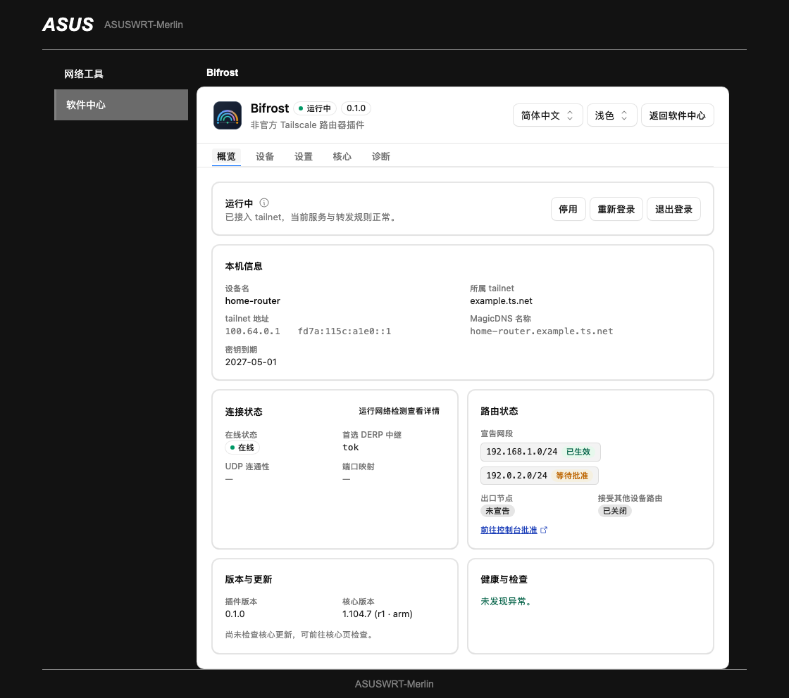

# Bifrost

[English](README.en.md) | 简体中文

**Bifrost** 是一个面向 KoolCenter / Koolshare 软件中心（华硕梅林 386/388 改版固件，HND 平台）的**非官方** Tailscale 插件。核心由本仓库依据公开配方从 Tailscale 官方源码编译，脚本完全以 BusyBox `/bin/sh` 开源编写，管理界面基于 Kumo 设计系统重新构建，支持简体中文 / 英文与深色 / 浅色外观切换。

> [!IMPORTANT]
> 本项目为非官方插件，与 Tailscale Inc. 及 Cloudflare, Inc. 均无关联，未获其认可或赞助。Tailscale 是 Tailscale Inc. 的商标。

## 与原版插件的区别

- **透明构建的核心**：从 Tailscale 官方稳定版源码交叉编译（当前配方 v1.104.7），编译脚本与省略功能清单全部公开，支持跨机器复现构建与哈希比对；默认不经 UPX 压缩，命令行调用延迟显著降低，离线安装包内使用 gzip 压缩存放核心以减小 JFFS 空间门槛。
- **完全开源的脚本**：所有插件脚本均以 BusyBox POSIX `/bin/sh` 明文编写，不做编译或混淆，所有外部输入先经白名单校验，无 `eval`，状态变更操作统一加互斥锁。
- **独立管理的防火墙规则**：`tailscaled` 运行在 `--netfilter-mode=off` 模式，由 Bifrost 独立维护 `BIFROST_*` 链，固件重建防火墙后仅刷新规则，不重启 daemon、不中断已有 tailnet 连接；「允许 tailnet 访问路由器本机」开关真实生效，且不误伤 WAN 口运营商级 NAT（`100.64.0.0/10`）。
- **重新设计的管理页面**：采用 Shadow DOM 隔离固件外壳，完整展示设备列表、连接路径、路由批准状态、核心更新与诊断脱敏输出，支持中英文和深浅色切换并持久化在路由器配置中。
- **支持自建控制服务器与原版迁移**：内置 headscale 客户端登录（交互式与预授权密钥），支持从原版插件一键「迁移并切换」并具备失败自动回滚。

## 界面预览

| 概览（深色） | 概览（浅色） |
|---|---|
|  |  |

| 设备列表 | 设置 |
|---|---|
|  |  |

| 核心管理 | 诊断 |
|---|---|
|  |  |

| 英文界面 | 窄屏布局（420 px） |
|---|---|
|  |  |

> [!NOTE]
> 界面在 `ASUSWRT` 固件皮肤下开发设计；`ROG`、`TUF`、`TS` 皮肤暂无实机测试。插件应用运行于 Shadow DOM 内，视觉样式不随固件外壳皮肤改变。

## 安装与升级

### 环境要求

- KoolCenter / Koolshare 软件中心（386/388 改版固件，HND 平台，`armv7l` 或 `aarch64` 内核）
- 内核支持 `/dev/net/tun`（或可加载 `tun` 模块）
- 软件中心已具备 `jq`、`openssl`、`curl`、`gunzip`
- 现代浏览器（Chrome / Edge 123+、Safari 17.5+、Firefox 128+）

### 离线安装步骤

1. 在 GitHub Releases 下载 `bifrost-<版本>-hnd.tar.gz`（可选：同时下载 `SHA256SUMS` 与 `SHA256SUMS.sig` 按下方「核心更新与签名」一节核对完整性与签名）。
2. 打开路由器管理后台 → **软件中心** → **离线安装**，选择下载的 `.tar.gz` 文件上传安装。
3. **首次安装不会自动启动服务，也不会改动原版插件。** 安装完成后进入 Bifrost 页面按需启用或迁移。
4. 升级安装直接上传新版离线包覆盖即可：已有设置与登录状态目录完整保留；升级前正在运行的服务会在升级完成后自动重启；若已在线更新到更新的核心版本，升级包不会将核心降级。

## 从原版插件迁移

Bifrost 与原版 `tailscale` 插件使用完全独立的模块名、dbus 键、脚本路径、socket 和状态目录，可以并存安装，但**不能同时运行**（两者共用 `tailscale0` 网卡与设备身份）。

### 一键迁移

1. 安装 Bifrost 后不要直接启用（安装不会停止原版）。
2. 打开 Bifrost 页面，在概览页点击 **「迁移并切换」**。
3. 迁移脚本会在后台执行（不依赖浏览器连接，避免通过 tailnet 操作时中断）：记录原版设备 ID 与公钥 → 备份已有 Bifrost 状态 → 停止原版（或等待你在原版页面手动关闭）→ 复制 `tailscaled.state` 与 `derpmap.cached.json`（只读原版，不修改原版任何文件）→ 启动 Bifrost 并验证设备身份一致。
4. 若验证失败，脚本会自动停用 Bifrost、恢复备份并提示切回原版。

### 迁移后与手动切回

- 宣告网段、接受路由等 Tailscale 自身配置保存在 state 文件中，会随状态文件一起迁入。
- 原版状态目录 `/koolshare/configs/tailscale/` 保持原样；但在 Bifrost 中执行**重新登录**或发生**密钥轮换**后，原版那份状态会过期，届时若切回原版需要重新登录。
- **手动切回原版**：在 Bifrost 页面关闭「启用 Bifrost」，随后到原版插件页面重新启用即可。

## 自建控制服务器（headscale）

Bifrost 支持作为客户端接入自建控制服务器（当前容器测试验证版本：**headscale v0.29.7**）：

- 在登录界面的「高级选项」中填写控制服务器地址（`https://...` 或 `http://...`，建议使用带公共 CA 证书的 HTTPS；路由器使用系统 CA 包且核心内置 Let's Encrypt 根证书，**不支持自签证书**）。
- 支持**交互式登录**（页面展示 `AuthURL` 与二维码，由管理员在控制台批准设备）与**预授权密钥**登录。
- 非官方控制服务器下，系统会强制开启 `--no-logs-no-support`，不向 Tailscale 上传遥测日志。
- 宣告的子网路由与出口节点需在控制服务器侧批准（`headscale nodes approve-routes` 或策略 `autoApprovers`）。
- 切换不同控制服务器时会新建独立登录档案，旧档案保留在 state 目录中，可在 SSH 中运行 `bifrost switch` 切回。

> [!WARNING]
> **预授权密钥安全提示**：请使用一次性、短有效期的预授权密钥。密钥不会写入 dbus 或日志，执行后立即删除临时密钥文件；但在提交瞬间它会短暂出现在请求参数中，若路由器后台使用 HTTP，局域网内为明文传输（与路由器后台管理密码安全级别一致）。

## 设置项说明

| 设置项 | 默认值 | 说明 |
|---|---|---|
| 启用 Bifrost | 关 | 控制服务启停与开机自启（`S99bifrost.sh`）。 |
| 宣告网段 | 空 | 向 tailnet 宣告路由器背后的 IPv4 CIDR（最多 16 条，禁止 `0.0.0.0/0`），保存后展示每条的批准状态。 |
| 作为出口节点 | 关 | 允许 tailnet 设备借本路由器上网，需在控制服务器批准。 |
| 接受其他设备宣告的路由 | 关（迁移保留原值） | 接收其他设备宣告的网段；若与本机局域网网段重叠会给出阻断警告。 |
| 设备名 | 空（系统主机名） | 自定义 tailnet 主机名（1–63 位字母、数字、连字符）。 |
| 监听端口 | `41641` | 固定 WireGuard UDP 监听端口（1024–65535），便于防火墙与上级路由端口映射；修改后会重启服务。 |
| 允许 tailnet 访问路由器本机 | 开 | 关闭后禁止来自 `tailscale0` 的本机入站连接（保留 ICMP 与已建立连接），但仍可经路由器访问后端局域网设备；从 tailnet 访问后台时关闭会触发确认警告。 |
| 局域网设备访问 tailnet | 开 | 对出 `tailscale0` 的流量做源地址转换（MASQUERADE），使局域网内未装 Tailscale 的设备可直接访问 tailnet；两地局域网互通且需保留源 IP 时可关闭。 |
| 进局域网时转换源地址 | 自动 | `自动`：路由模式关闭、AP 模式开启；`开`：强制转换（局域网设备看到路由器 LAN IP）；`关`：保留 tailnet 源 IP。 |
| 局域网解析 tailnet 主机名 | 关 | 写入 `/jffs/configs/dnsmasq.d/bifrost.conf` 将 MagicDNS 后缀转发至 `100.100.100.100` 并重启 dnsmasq；停止或卸载时自动清除。 |
| 不向 Tailscale 上传日志 | 开 | 开启 `--no-logs-no-support`；使用自建控制服务器时锁定为开。 |
| 下载镜像 | 空 | 核心更新下载前缀（`https://.../`）；所有下载均先验签再核对哈希，镜像不可信也不影响安全性。 |

### 与透明代理类插件共存

- 使用透明代理类插件（如 heimdall、merlinclash、fancyss 等）时，请确保将 `100.64.0.0/10` 及已接受的对端网段加入绕过 / 直连规则，避免 tailnet 流量被错误接管。
- 若其他插件持续在 iptables 主链首位插入跳转导致与 Bifrost 守护抢位，守护会在脚本日志（`/tmp/bifrost-run/bifrost.log`）中记录告警；请调整对应插件的规则顺序或绕过配置。

### 命令行提示

- 通过 SSH 可直接使用 `bifrost <子命令>`（例如 `bifrost status`、`bifrost ping`、`bifrost switch`），它已自动绑定 Bifrost 的独立 socket。
- 通过页面执行「重新登录」时使用 `tailscale up --reset`，仅保留页面管理的参数；经命令行设置的其余参数会恢复默认值。

## 核心更新与签名

- 核心独立发布于 `core-<Tailscale 版本>-<revision>`，并同步更新 `channel-stable` 通道的 `core.json` 与 `core.json.sig`。
- **签名算法**：ECDSA P-256 + SHA-256（兼容路由器 OpenSSL 1.1.1w）。公钥位于 `/koolshare/bifrost/keys/*.pub.pem`，支持多公钥平滑轮换。
- **防降级与自动回滚**：清单中的 `serial` 单调递增，路由器拒绝安装不大于当前 `serial` 的核心；更新时先验清单签名 → 校验 `.gz` 与解压后 `raw_sha256` → 试运行 `--version` → 替换后 60 秒内验证服务恢复，失败则自动换回旧核心与状态快照；空间充足时保留 `bifrostd.prev.gz` 供手动回退。
- **核对离线包签名**（在本地终端执行）：

```sh
openssl dgst -sha256 -verify plugin/bifrost/keys/<公钥>.pub.pem \
  -signature SHA256SUMS.sig SHA256SUMS
sha256sum -c SHA256SUMS
```

## 卸载

在 **软件中心** 点击卸载（实际执行 `/koolshare/scripts/uninstall_bifrost.sh`）：

- 自动停止服务，清理定时守护任务、`BIFROST_*` 防火墙链、dnsmasq 配置、插件全部程序文件、脚本、页面资源、运行时目录 `/tmp/bifrost-run/`、临时上传文件与全部 `bifrost_*` / `softcenter_module_bifrost_*` dbus 键。
- **默认保留登录状态目录**：`/koolshare/configs/bifrost/` 不会被删除，重新安装后无需再次登录。
- **彻底清除登录状态**：如需彻底清除，请在卸载前先打开 Bifrost 的 **「诊断」** 页点击 **「清除登录状态」**（或卸载后通过 SSH 手动删除 `/koolshare/configs/bifrost/`）。
- **卸载不自动退出登录**：不会向控制服务器发送 `logout`，设备在控制台中会显示为离线，如不再使用请在控制台中自行删除该设备。

## 限制（v1 不包含）

| 项目 | 说明 |
|---|---|
| Tailscale SSH、Taildrop、Taildrive、web client | 编译时移除，减小体积与攻击面。 |
| 核心自动更新与 `tailscale update` | 仅提供手动检查与更新按钮，避免官方更新器覆盖自编译核心。 |
| 路由器「使用出口节点」 | 改写全屋默认路由风险高，v1 仅提供「作为出口节点」（命令行仍可自行配置）。 |
| `--accept-dns` | 固定关闭，避免改写固件 `/etc/resolv.conf`；MagicDNS 通过 dnsmasq 转发提供。 |
| IPv6 子网路由与 NAT | v1 仅放行 IPv6 直连 UDP 与路由器自身 tailnet IPv6 地址。 |
| headscale 服务端管理 | 仅作为客户端接入，不内置服务端、不调用服务端 API。 |
| 多登录档案图形管理 | 切换服务器保留旧档案，切回需使用命令行 `bifrost switch`。 |
| 380 老固件、ARMv5、非 HND 平台 | v1 仅支持 HND 平台（`.valid` 为 `hnd`）。 |

## 开发与文档

详细设计方案、接口约定、测试运行、打包与发布说明见 [docs/README.md](docs/README.md)。

## 许可证

- 本仓库插件脚本、界面与构建工具采用 [MIT License](LICENSE)。
- 打包内附的 Tailscale 核心遵循 BSD-3-Clause 许可证，见 [packaging/LICENSE.tailscale](packaging/LICENSE.tailscale)。
- 第三方组件与改写来源声明见 [NOTICE.md](NOTICE.md)。
