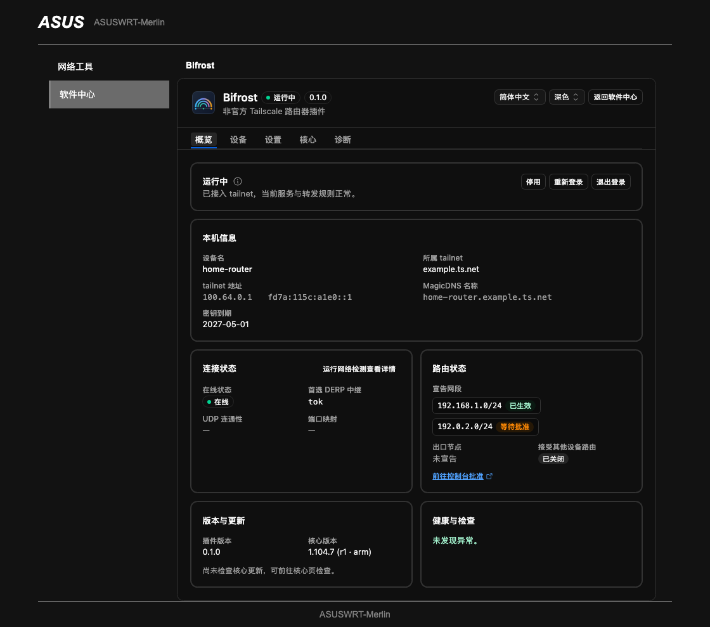
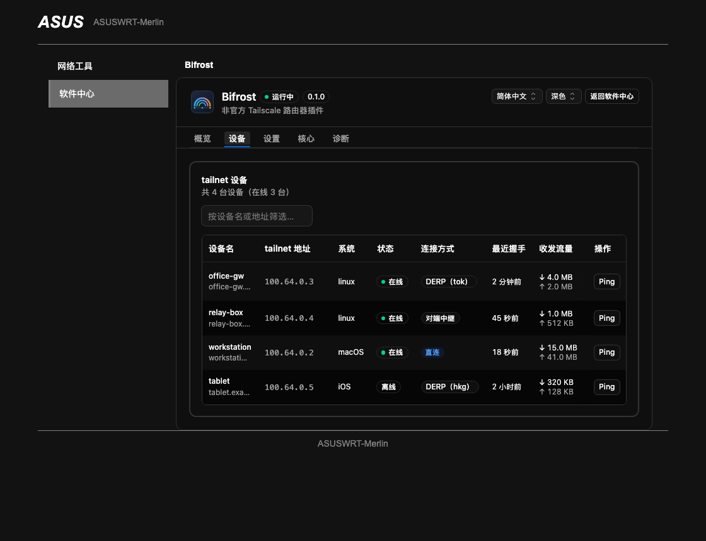
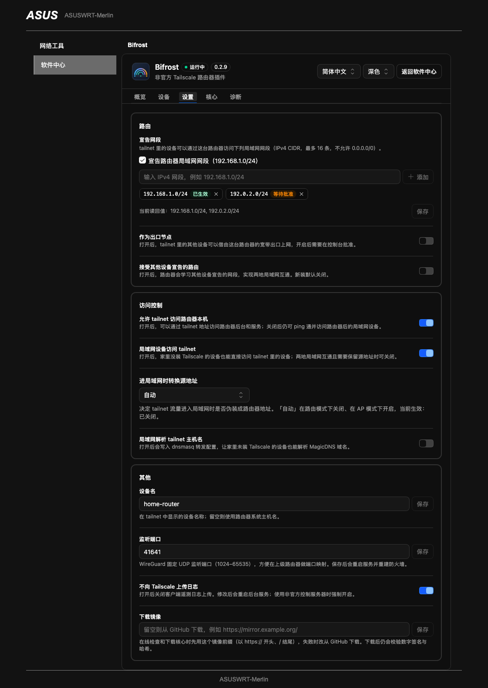
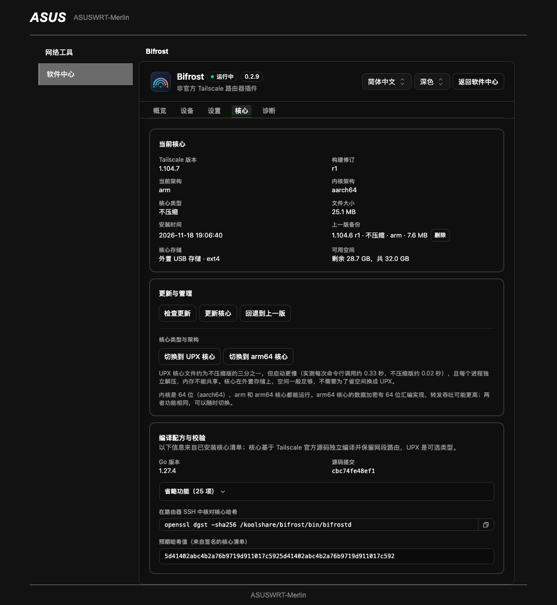
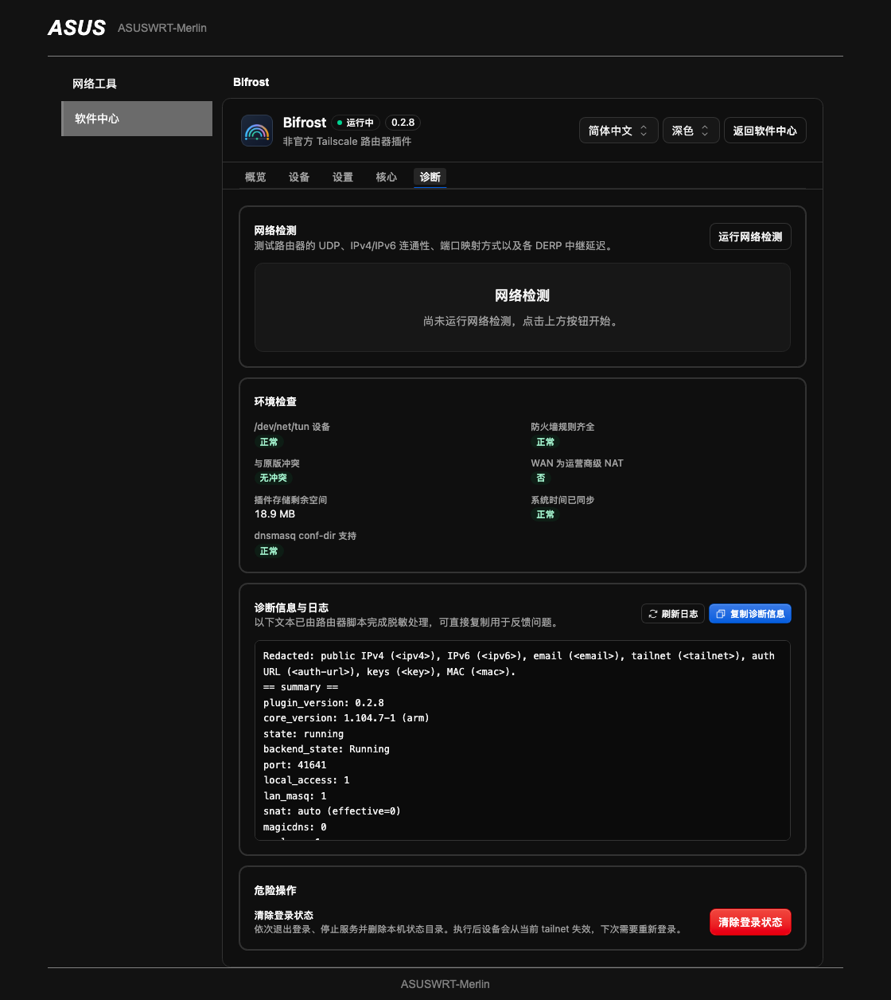
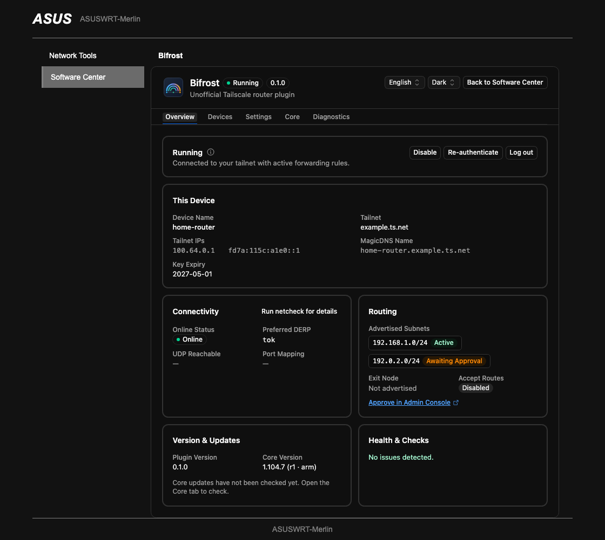
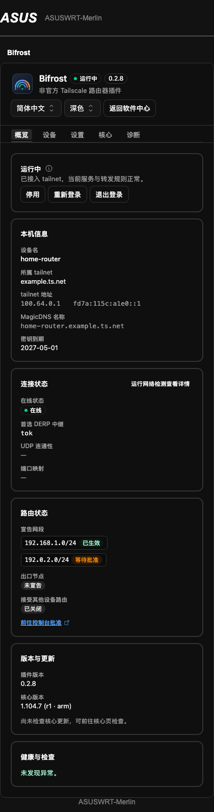

# Bifrost

[English](README.en.md) | 简体中文

**Bifrost** 是面向 KoolCenter / Koolshare 软件中心（华硕梅林 386/388 改版固件，HND 平台）的**非官方** Tailscale 插件。核心按公开配方从 Tailscale 官方源码编译，脚本以 BusyBox `/bin/sh` 开源编写。管理页面基于 Kumo 设计系统构建，支持简体中文 / 英文与深色 / 浅色外观切换。

> [!IMPORTANT]
> 本项目为非官方插件，与 Tailscale Inc. 无关联，未获其认可或赞助。Tailscale 是 Tailscale Inc. 的商标。

## 与原版插件的区别

- **透明、可复现的核心**：按公开配方（`core/recipe.json`）和编译脚本，从 Tailscale 官方稳定版源码交叉编译（当前为 v1.104.7），并公开完整 featuretags 和省略功能清单。你可以自行重新编译并比对哈希。默认核心以未压缩形式安装到 JFFS，命令行启动耗时约 0.02 秒。需要节省核心文件空间时可选 UPX 版：arm 核心文件从 25.1 MB 降到 7.7 MB（JFFS 本身会压缩文件，实际节省更少），但在 RT-AX86U 上每次命令行调用约 0.33 秒，且每个进程独立解压、不能共享内存。离线安装包内用 gzip 压缩存放核心，以降低软件中心安装时的空间检查门槛。
- **开源的路由器脚本**：所有插件脚本均以 BusyBox POSIX `/bin/sh` 明文编写，不经 `shc` 封装或混淆。外部输入先经白名单校验，不使用 `eval`。修改状态的操作统一加互斥锁。
- **独立管理的防火墙规则**：`tailscaled` 运行在 `--netfilter-mode=off` 模式，由 Bifrost 维护 `BIFROST_*` 链。固件重建防火墙后，Bifrost 只重新应用规则，不重启后台服务，也不中断已有 tailnet 连接。「允许 tailnet 访问路由器本机」开关真实生效，且不丢弃 WAN 口运营商级 NAT（`100.64.0.0/10`）流量。
- **重做的管理页面**：页面运行在 Shadow DOM 内，不干扰固件外壳。页面展示设备列表、连接路径与中继状态、路由批准状态、签名核心更新和脱敏诊断信息。支持中英文与深浅色切换，偏好保存在路由器配置中。
- **自建控制服务器与原版迁移**：支持作为客户端接入 headscale（交互式登录与预授权密钥），并支持从原版插件执行「迁移并切换」，验证失败时自动回滚。

## 界面预览

| 概览（深色） | 概览（浅色） |
|---|---|
|  |  |

| 设备列表 | 设置 |
|---|---|
|  |  |

| 核心管理 | 诊断 |
|---|---|
|  |  |

| 英文界面 | 窄屏布局（420 px） |
|---|---|
|  |  |

> [!NOTE]
> 界面面向 `ASUSWRT` 固件皮肤开发；`ROG`、`TUF`、`TS` 皮肤暂无实机测试。插件界面运行在 Shadow DOM 内，样式不受固件外壳皮肤影响。

## 安装与升级

### 环境要求

- KoolCenter / Koolshare 软件中心（386/388 改版固件，HND 平台，`armv7l` 或 `aarch64` 内核）
- 内核支持 `/dev/net/tun`（或可加载 `tun` 模块）
- 路由器已具备 `jq`、`openssl`、`curl`、`gunzip`
- 现代浏览器（Chrome / Edge 123+、Safari 17.5+、Firefox 128+）

### 离线安装

1. 从 GitHub Releases 下载离线包：
   - `bifrost-<版本>-hnd.tar.gz`（默认 32 位 `arm` 核心，适用于全部 HND 机型，含 64 位内核 / 32 位用户态机型）。
   - 若对应核心发布包含 `arm64`，同时提供 `bifrost-<版本>-hnd-arm64.tar.gz`（仅限 `aarch64` 内核机型；也可以先装默认包，再到「核心」页在线切换）。
   - 可选压缩包：`bifrost-<版本>-hnd-upx.tar.gz` 和 `bifrost-<版本>-hnd-arm64-upx.tar.gz`。只在需要节省核心文件空间时选择，页面也可以在线切换核心类型。
   - 可选：同时下载 `SHA256SUMS` 与 `SHA256SUMS.sig`，上传前按下方「核心更新与签名」一节核对签名和哈希。
2. 打开路由器管理后台 → **软件中心** → **离线安装**，上传下载的 `.tar.gz` 文件。
3. **首次安装不会自动启动后台服务，也不会改动原版插件。** 安装完成后进入 Bifrost 页面，按需启用或从原版迁移。

### 升级

- 在 **软件中心** → **离线安装** 中直接上传新版离线包覆盖安装。
- 已有设置与登录状态目录会保留。
- 升级前正在运行的后台服务会在升级后自动重启；若升级在停止服务后中止，安装脚本会尝试恢复原服务。
- 若路由器已在线更新到更新的核心（`serial` 更大），旧包不会降级核心。

## 从原版插件迁移

Bifrost 与原版 `tailscale` 插件使用独立的模块名、dbus 键、脚本路径、socket 和状态目录，可以并存安装。两者共用 `tailscale0` 网卡与设备身份，**不能同时运行**。

### 页面迁移

1. 安装 Bifrost 后先不要启用（安装不会停止原版插件）。
2. 打开 Bifrost 的「概览」页，点击 **「迁移并切换」**。
3. 迁移在后台执行，不依赖浏览器连接，通过 tailnet 操作也不会中途断开。脚本按顺序执行以下步骤：
   - 记录原版设备 ID 与公钥；
   - 备份已有的 Bifrost 状态；
   - 通过原版自己的脚本停止原版插件，并关闭其开机启动；
   - 只读复制 `tailscaled.state` 与 `derpmap.cached.json`，不修改原版任何文件；
   - 启动 Bifrost 并验证设备身份一致；
   - 重建防火墙，清除原版遗留的 NAT 规则。
4. 若验证失败，脚本会自动停止并停用 Bifrost，恢复备份，重新启用并启动原版插件，并报告回滚结果。

### 迁移后与手动切回

- 宣告网段、接受路由等 Tailscale 自身配置存在状态文件中，会随状态一起迁入。
- 原版状态目录 `/koolshare/configs/tailscale/` 保持原样。但在 Bifrost 中执行**重新登录**或发生**密钥轮换**后，原版那份状态会过期；之后若切回原版，需要重新登录。
- **手动切回原版**：在 Bifrost 页面关闭「启用 Bifrost」，再到原版插件页面重新启用。

## 自建控制服务器（headscale）

Bifrost 支持作为客户端接入自建控制服务器（容器测试验证版本：**headscale v0.29.7**）：

- 在登录界面的「高级选项」中填写控制服务器地址（`https://...` 或 `http://...`）。建议使用带公共 CA 证书的 HTTPS；路由器使用系统 CA 包，核心内置 Let's Encrypt 根证书，**不支持自签证书**。
- 支持**交互式登录**（页面展示 `AuthURL` 与二维码，由管理员在控制台批准设备）和**预授权密钥**登录。
- 使用非官方控制服务器时，系统强制开启 `--no-logs-no-support`，不向 Tailscale 上传遥测日志。
- 宣告的网段与出口节点需要在控制服务器批准（`headscale nodes approve-routes` 或策略 `autoApprovers`）。
- 切换控制服务器时会新建登录档案，旧档案保留在状态目录中；可在 SSH 中运行 `bifrost switch` 切回。

> [!WARNING]
> **预授权密钥安全提示**：请使用一次性、短有效期的预授权密钥。密钥不写入 dbus 或日志，执行后立即删除临时密钥文件。提交时密钥会短暂经过请求参数和脚本参数；若路由器后台使用 HTTP，局域网内为明文传输（安全边界与路由器后台管理密码相同）。

## 设置项说明

| 设置项 | 默认值 | 说明 |
|---|---|---|
| 启用 / 停用（「概览」页） | 关 | 控制后台服务启停与开机自启（`S99bifrost.sh`）。 |
| 宣告网段 | 空 | 向 tailnet 宣告路由器背后的 IPv4 CIDR（最多 16 条，禁止 `0.0.0.0/0`），保存后展示每条的批准状态。 |
| 作为出口节点 | 关 | 允许 tailnet 设备借本路由器上网，需在控制服务器批准。 |
| 接受其他设备宣告的路由 | 关（迁移保留原值） | 接收其他设备宣告的网段；若与本机局域网网段重叠，开启前会弹出确认警告。 |
| 设备名 | 空（系统主机名） | 自定义 tailnet 主机名（1–63 位字母、数字、连字符）。 |
| 监听端口 | `41641` | 固定 WireGuard UDP 监听端口（1024–65535），便于防火墙配置与上级路由端口映射；修改后会重启后台服务。 |
| 允许 tailnet 访问路由器本机 | 开 | 关闭后禁止来自 `tailscale0` 的本机入站连接（保留 ICMP 与已建立连接），仍可经路由器访问局域网设备；从 tailnet 访问后台时关闭会触发确认警告。 |
| 局域网设备访问 tailnet | 开 | 对出 `tailscale0` 的流量做源地址转换（MASQUERADE），让局域网内未装 Tailscale 的设备访问 tailnet；两地局域网互通且需保留源 IP 时可关闭。 |
| 进局域网时转换源地址 | 自动 | `自动`：路由模式关闭、AP 模式开启；`开`：始终转换（局域网设备看到路由器 LAN IP）；`关`：保留 tailnet 源 IP。 |
| 局域网解析 tailnet 主机名 | 关 | 写入 `/jffs/configs/dnsmasq.d/bifrost.conf`，将 MagicDNS 后缀转发至 `100.100.100.100` 并重启 dnsmasq；停止或卸载时自动清除。 |
| 不向 Tailscale 上传日志 | 开 | 开启 `--no-logs-no-support`；使用自建控制服务器时锁定为开。 |
| 下载镜像 | 空 | 核心更新下载前缀（`https://.../`）。填写后先用镜像，失败再走 GitHub；留空时先走 GitHub API，再走 github.com。所有下载均先验签再核对哈希，镜像不可信也不影响安全。 |

### 与透明代理类插件共存

- 使用透明代理类插件（如 heimdall、merlinclash、fancyss 等）时，将 `100.64.0.0/10` 及已接受的对端网段加入绕过或直连规则，避免拦截 tailnet 流量。
- 若其他插件反复在 iptables 主链首位插入跳转规则导致抢位，Bifrost 守护会恢复规则顺序，并在脚本日志（`/tmp/bifrost-run/bifrost.log`）中记录告警；请调整对应插件的规则顺序或绕过配置。

### 命令行提示

- 在 SSH 中直接运行 `bifrost <子命令>`（例如 `bifrost status`、`bifrost ping`、`bifrost switch`），它已自动绑定 Bifrost 的独立 socket。
- 通过页面执行「重新登录」时会运行 `tailscale up --reset`，只保留页面管理的参数；经命令行设置的其余参数会恢复默认值。

## 核心更新与签名

- 核心独立发布于 `core-<Tailscale 版本>-<revision>`，并同步更新 `channel-stable` 通道的 `core.json` 与 `core.json.sig`。
- 页面打开时会在超过 24 小时没有检查且没有其他任务运行时后台检查一次。检查失败不会弹错误，结果和时间会保存在 JFFS。发现新核心只提示并等待用户点击更新，插件新版本提供发布页链接，安装仍通过软件中心离线包完成。
- **签名算法**：ECDSA P-256 + SHA-256（兼容路由器 OpenSSL 1.1.1w）。公钥位于 `/koolshare/bifrost/keys/*.pub.pem`，支持多公钥轮换。
- **防降级与回滚**：清单中的 `serial` 单调递增，用于防范重放和降级，路由器拒绝安装不大于当前 `serial` 的核心。更新时先验证清单签名，再核对 `.gz` 与解压后的 `raw_sha256`，试运行 `--version`，替换后在 60 秒内验证后台服务恢复；验证失败时自动换回旧核心与状态快照。JFFS 空间充足时保留 `bifrostd.prev.gz`，供手动回退。
- **核对离线包签名与哈希**：先验证 `SHA256SUMS` 签名，再核对离线包哈希（在本地终端执行，支持仅下载单个包）。公钥取自本仓库对应发布 tag 下的 `plugin/bifrost/keys/`：

```sh
# 1. 验证 SHA256SUMS 签名
pubkey=plugin/bifrost/keys/release-1.pub.pem  # 改为发行方提供的可信公钥
openssl dgst -sha256 -verify "$pubkey" \
  -signature SHA256SUMS.sig SHA256SUMS

# 2. 校验已下载的离线包（Linux）
sha256sum -c --ignore-missing SHA256SUMS

# 2. 校验已下载的离线包（macOS）
shasum -a 256 -c --ignore-missing SHA256SUMS
```

## 卸载

在 **软件中心** 点击卸载（实际执行 `/koolshare/scripts/uninstall_bifrost.sh`）：

- **停止并清理**：自动停止后台服务（若服务无法停止，卸载会中止并保留脚本以便重试）。随后清理守护任务（`bifrost_watchdog`）、`BIFROST_*` 防火墙链、dnsmasq 配置、插件程序文件、脚本、页面资源、运行时目录 `/tmp/bifrost-run/`、临时上传文件（`/tmp/upload/bifrost_*`）以及全部 `bifrost_*` 与 `softcenter_module_bifrost_*` dbus 键。
- **默认保留登录状态目录**：`/koolshare/configs/bifrost/` 不会被删除，重新安装后无需再次登录。
- **清除登录状态**：如需彻底清除，卸载前先到 Bifrost 的「诊断」页点击 **「清除登录状态」**，或在卸载后通过 SSH 手动删除 `/koolshare/configs/bifrost/`。
- **卸载不自动退出登录**：卸载不向控制服务器发送 `logout`。设备在控制台中会显示为离线，不再使用时请在控制台中自行删除。

## 限制（v1 不包含）

| 项目 | 说明 |
|---|---|
| Tailscale SSH、Taildrop、Taildrive、web client | 编译时移除，减小体积与攻击面。 |
| 核心自动安装与 `tailscale update` | 只自动检查，不自动安装。官方更新器会用官方包覆盖自编译核心，已在编译时去掉。 |
| 路由器「使用出口节点」 | 改写全屋默认路由风险高，v1 仅提供「作为出口节点」（命令行仍可自行配置）。 |
| `--accept-dns` | 固定关闭，避免改写固件 `/etc/resolv.conf`；MagicDNS 通过 dnsmasq 转发提供。 |
| IPv6 子网路由与 NAT | v1 仅放行 IPv6 直连 UDP 与路由器自身 tailnet IPv6 地址。 |
| headscale 服务端管理 | 仅作为客户端接入，不内置服务端、不调用服务端 API。 |
| 多登录档案图形管理 | 切换服务器时保留旧档案，切回需使用命令行 `bifrost switch`。 |
| 380 老固件、ARMv5、非 HND 平台 | v1 仅支持 HND 平台（`.valid` 为 `hnd`）。 |

## 开发与文档

详细设计方案、接口约定、测试运行、打包与发布说明见 [docs/README.md](docs/README.md)。

## 许可证

- 插件脚本、界面与构建工具采用 [MIT License](LICENSE)。
- 打包内附的 Tailscale 核心采用 BSD-3-Clause 许可证，见 [packaging/LICENSE.tailscale](packaging/LICENSE.tailscale)。
- 核心静态链接的 Go 模块与前端第三方依赖声明见 [NOTICE.md](NOTICE.md) 及 [packaging/THIRD_PARTY_NOTICES.core.md](packaging/THIRD_PARTY_NOTICES.core.md)。
